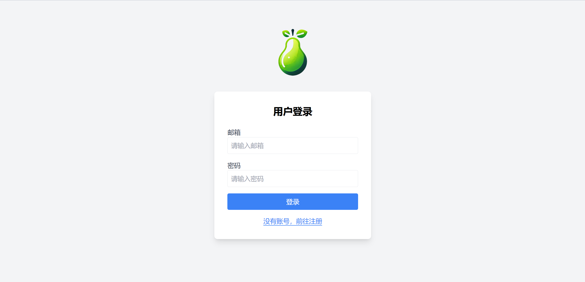
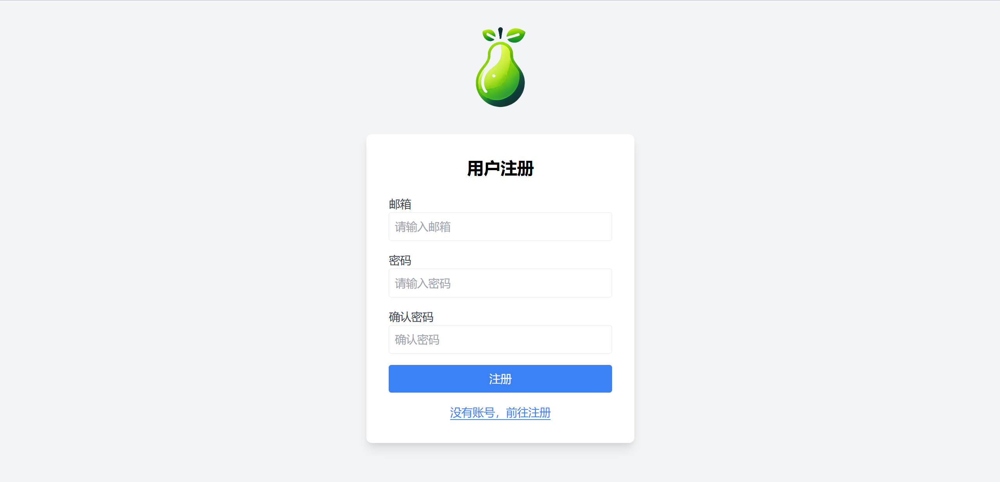
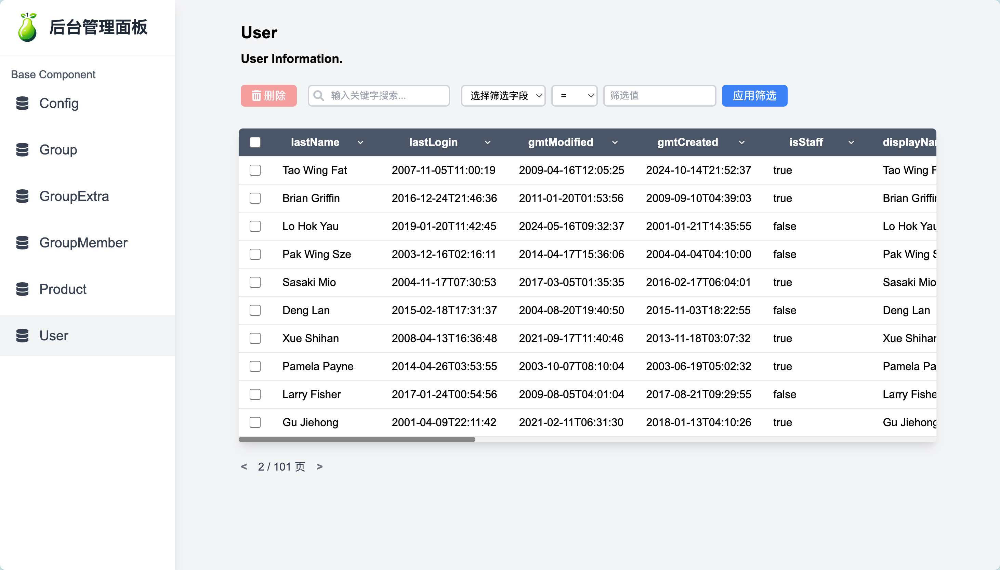

# Pear Spring Boot Starter

<div align="center">
  
  <p>A Spring Boot starter for quickly building admin backends in monolithic applications.</p>
  <p><a href="README.md">中文</a> | <a href="README_EN.md">English</a></p>
  <p>
    <a href="https://spring.io/projects/spring-boot"></a>
    <a href="https://www.oracle.com/java/"></a>
    <a href="https://mybatis.org/"></a>
    <a href="https://maven.apache.org/"></a>
  </p>
</div>

## Overview

Pear helps Spring Boot applications add a visual admin backend with minimal boilerplate. Add `@PearApplication` to enable the starter, then annotate entity classes with `@PearObject` and `@PearField`. Pear collects model metadata at startup and exposes unified CRUD APIs, user authentication pages, permission checks, and configurable caching.

Key features:

- Annotation-driven admin model registration
- Built-in login, register, dashboard, and settings pages
- Generic `/admin/{model}` CRUD APIs
- RBAC roles and permissions with `@Verification`
- LRU, LFU, and Redis cache implementations
- Configuration through properties or custom beans
- Maven Central ready build outputs: main jar, sources jar, javadoc jar, and GPG signing

## Modules

| Module | Description |
| --- | --- |
| `pear-spring-boot-starter` | Public starter, auto-configuration entry, templates, static assets, and SQL scripts |
| `pear-spring-boot-basic` | Configuration objects, properties, exceptions, and auto-configuration |
| `pear-spring-boot-core` | Annotations, entities, DAO, services, AdminObject container, and permission aspect |
| `pear-spring-boot-web` | Web APIs, page routes, and JWT interceptor |
| `pear-spring-boot-cache` | Cache container, cache factory, LRU/LFU/Redis implementations |
| `pear-spring-boot-utils` | JWT, time, string, ID, and naming utilities |
| `pear-spring-boot-constant` | Framework constants |

## Requirements

- JDK 17 or newer
- Maven 3.9 or newer
- Spring Boot 3.3.x
- MySQL or another data source compatible with JPA and MyBatis-Plus

Pear publishes Java 17 compatible bytecode. The parent POM uses `maven.compiler.release=17`, so Maven may run on newer JDKs such as JDK 21 or JDK 25 while still producing Java 17 compatible artifacts.

## Quick Start

### 1. Add Dependency

```xml
<dependency>
  <groupId>cn.muzisheng.pear</groupId>
  <artifactId>pear-spring-boot-starter</artifactId>
  <version>1.3.1</version>
</dependency>
```

### 2. Enable Pear

```java
import cn.muzisheng.pear.PearApplication;
import org.springframework.boot.SpringApplication;
import org.springframework.boot.autoconfigure.SpringBootApplication;

@SpringBootApplication
@PearApplication
public class DemoApplication {
    public static void main(String[] args) {
        SpringApplication.run(DemoApplication.class, args);
    }
}
```

### 3. Configure Data Source

```properties
spring.datasource.url=jdbc:mysql://localhost:3306/pear_demo?useUnicode=true&characterEncoding=utf8&serverTimezone=UTC
spring.datasource.username=root
spring.datasource.password=your_password
spring.datasource.driver-class-name=com.mysql.cj.jdbc.Driver

spring.jpa.hibernate.ddl-auto=update
spring.jpa.show-sql=false
```

### 4. Create a Superuser

Pass `-u` and `-p` when starting the application to create or update the superuser password:

```bash
java -jar demo.jar -u admin@example.com -p your_password
```

Default pages:

| Page | URL |
| --- | --- |
| Login | `http://localhost:8080/auth/login` |
| Register | `http://localhost:8080/auth/register` |
| Dashboard | `http://localhost:8080/auth/dashboard` |
| Settings | `http://localhost:8080/auth/settings` |

## Entity Integration

Use `@PearObject` to register an entity as an admin model, and `@PearField` to describe field behavior for display, editing, filtering, sorting, and searching. Entities may still use JPA and MyBatis-Plus annotations.

```java
package cn.muzisheng.pear.example;

import cn.muzisheng.pear.annotation.PearField;
import cn.muzisheng.pear.annotation.PearObject;
import com.baomidou.mybatisplus.annotation.FieldFill;
import com.baomidou.mybatisplus.annotation.TableField;
import com.baomidou.mybatisplus.annotation.TableName;
import jakarta.persistence.*;
import lombok.Data;
import org.springframework.stereotype.Component;

import java.time.LocalDateTime;

@Data
@Component
@Entity(name = "product")
@TableName("product")
@PearObject(
    group = "shop",
    desc = "Product information.",
    path = "/product",
    pluralName = "products"
)
public class Product {
    @Id
    @GeneratedValue(strategy = GenerationType.IDENTITY)
    @PearField(isPrimaryKey = true, isEdit = false, label = "ID")
    private Long id;

    @Column(nullable = false)
    @PearField(label = "Name", placeholder = "Product name")
    private String name;

    @PearField(label = "Price", isFilterable = true, isOrderable = true)
    private Double price;

    @TableField(fill = FieldFill.INSERT, value = "gmt_created")
    @Column(name = "gmt_created")
    @PearField(isEdit = false, isAutoInsertTime = true, label = "Created At")
    private LocalDateTime gmtCreated;

    @Transient
    private String displayText;
}
```

### `@PearObject`

| Attribute | Default | Description |
| --- | --- | --- |
| `TableName` | `""` | Database table name. JPA `@Entity(name=...)` and MyBatis-Plus `@TableName` take priority |
| `group` | `""` | Admin model group |
| `desc` | `""` | Model description |
| `path` | `""` | Model access path |
| `editPage` | `""` | Custom edit page |
| `listPage` | `""` | Custom list page |
| `pluralName` | `""` | Plural model name |
| `iconUrl` | `""` | Model icon URL |
| `isInvisible` | `false` | Whether to hide the model in admin UI |
| `isLoad` | `true` | Whether to load the entity into Pear's admin model container |

### `@PearField`

| Attribute | Default | Description |
| --- | --- | --- |
| `isShow` | `true` | Whether to display the field |
| `isEdit` | `true` | Whether the field can be edited |
| `isFilterable` | `true` | Whether the field can be filtered |
| `isOrderable` | `true` | Whether the field can be sorted |
| `isSearchable` | `true` | Whether the field is used in keyword search |
| `isRequire` | `true` | Whether the field is required |
| `isPrimaryKey` | `false` | Whether the field is a primary key |
| `isUniqueKey` | `false` | Whether the field is a unique key |
| `placeholder` | `""` | Form placeholder text |
| `isAutoUpdateTime` | `false` | Fill current time on update |
| `isAutoInsertTime` | `false` | Fill current time on create |
| `label` | `""` | Display label |

### Customize Model Metadata

Pear collects `@PearObject` entities into `AdminContainer` during bean initialization. Use `AdminContainer.AdminFactory` in a `CommandLineRunner` to add hooks, ordering, display fields, and access checks.

```java
import cn.muzisheng.pear.Constant;
import cn.muzisheng.pear.initialize.AdminContainer;
import cn.muzisheng.pear.model.Order;
import org.springframework.boot.CommandLineRunner;
import org.springframework.stereotype.Component;

@Component
public class PearAdminInitializer implements CommandLineRunner {
    @Override
    public void run(String... args) {
        AdminContainer.AdminFactory factory = new AdminContainer.AdminFactory("product");

        factory.addOrder(new Order("gmt_created", Constant.ORDER_OP_DESC));
        factory.setBeforeCreate((request, adminObject, data) -> {
            data.putIfAbsent("name", "Untitled product");
        });
        factory.setAccessCheck((request, adminObject, user) -> user.getEnabled());
    }
}
```

## Configuration

Default configuration can be overridden through `application.properties` or by declaring custom beans.

```properties
# Cache
pear.starter.cache.expire=86400000
pear.starter.cache.capacity=200
pear.starter.cache.strategy=LRU
pear.starter.cache.time-unit=MILLISECONDS

# Token
pear.starter.token.head=Bearer 
pear.starter.token.expire=604800000
pear.starter.token.issue=pear
pear.starter.token.subject=authentication

# User
pear.starter.user.password-salt=PEAR_APPLICATION_SALT

# Site
pear.starter.site.auth-prefix=/auth

# Log
pear.starter.log.level=INFO
pear.starter.log.file-path=log
pear.starter.log.log-catalogue-address=log/log-day
pear.starter.log.warn-catalogue-address=log/warn-day
pear.starter.log.error-catalogue-address=log/error-day
```

Custom bean example:

```java
import cn.muzisheng.pear.config.CacheConfig;
import cn.muzisheng.pear.config.TokenConfig;
import cn.muzisheng.pear.config.UserConfig;
import cn.muzisheng.pear.model.CacheStrategyEnum;
import org.springframework.context.annotation.Bean;
import org.springframework.context.annotation.Configuration;

@Configuration
public class PearConfig {
    @Bean
    public CacheConfig cacheConfig() {
        return new CacheConfig.Builder()
            .expire(3600000)
            .capacity(500)
            .strategy(CacheStrategyEnum.LFU)
            .build();
    }

    @Bean
    public TokenConfig tokenConfig() {
        return TokenConfig.builder()
            .head("Bearer ")
            .expire(86400000L)
            .issue("pear-admin")
            .subject("authentication")
            .build();
    }

    @Bean
    public UserConfig userConfig() {
        return new UserConfig.Builder()
            .passwordSalt("custom-user-salt")
            .build();
    }
}
```

## API Overview

### User APIs

| Method | Path | Description |
| --- | --- | --- |
| `POST` | `/user/register` | Register a user |
| `POST` | `/user/login` | Login and return token |
| `POST` | `/user/info` | Get current user info |

### Admin APIs

Admin APIs are intercepted by `JWTInterceptor`; pass the token in the `Authorization` header.

| Method | Path | Description |
| --- | --- | --- |
| `GET` | `/admin/` | Get static resource and admin model metadata |
| `POST` | `/admin/json` | Get current user, site context, and model metadata |
| `POST` | `/admin/{model}` | Query list, or get one item by primary/unique key when body is empty |
| `PUT` | `/admin/{model}` | Create data |
| `PATCH` | `/admin/{model}` | Update data |
| `DELETE` | `/admin/{model}` | Delete data |

## Permissions

Pear includes an RBAC permission model and validates requests through the `@Verification` aspect:

- System-level verification checks whether the current user has the required permission code.
- User-level verification runs the model-level `AccessCheck` hook for custom business authorization.

Built-in permission codes:

| Permission | Description |
| --- | --- |
| `ADMIN_CREATE` | Create permission |
| `ADMIN_DELETE` | Delete permission |
| `ADMIN_UPDATE` | Update permission |
| `ADMIN_SELECT` | Select permission |
| `PERMISSION_WRITER` | Permission write operation |
| `PERMISSION_SYNC` | Permission lock |
| `ADMIN_NULL` | Empty permission |

Built-in roles:

| Role | Description |
| --- | --- |
| `superuser` | Super administrator with all admin permissions |
| `staff` | Staff user who can access admin and query data |
| `customer` | Customer user, not allowed to access admin by default |
| `finance` | Can read and write data except permissions |
| `secretary` | Can read and write data but cannot modify admin permissions |

## Build and Verify

```bash
mvn test
mvn -DskipTests package
mvn -DskipTests -Dgpg.skip verify
```

The `package` phase produces the following artifacts for each jar module:

- Main jar
- `-sources.jar`
- `-javadoc.jar`

## Publish to Maven Central

The project uses Sonatype Central Publisher Portal through `central-publishing-maven-plugin`. Before publishing, make sure:

- The namespace has been verified in Central Portal.
- `~/.m2/settings.xml` contains a server with id `central`.
- A usable GPG private key is available locally or in CI.
- The release version has not already been published.

Example `settings.xml`:

```xml
<settings>
  <servers>
    <server>
      <id>central</id>
      <username>your-token-username</username>
      <password>your-token-password</password>
    </server>
  </servers>
</settings>
```

Publish with:

```bash
mvn clean deploy
```

## Page Preview

| Login | Register | Dashboard |
| --- | --- | --- |
|  |  |  |

## Changelog

| Version | Description |
| --- | --- |
| `1.3.1` | Fixed Admin handling for custom entity inheritance; unified Java 17 build and Maven Central publishing setup |

## Roadmap

- Improve the third-generation permission system.
- Refactor Admin DAO toward safer parameterized SQL.
- Add event observation for registration, login, and data changes.
- Improve log archiving and observability.
- Improve frontend editing, deletion, and password change flows.

## Contributing

1. Fork this repository.
2. Create a feature branch: `git checkout -b feature/your-feature`.
3. Commit changes: `git commit -m "Add your feature"`.
4. Push the branch: `git push origin feature/your-feature`.
5. Open a Pull Request.

## License

[Apache License 2.0](http://www.apache.org/licenses/LICENSE-2.0) © 2025 MuziSuper
